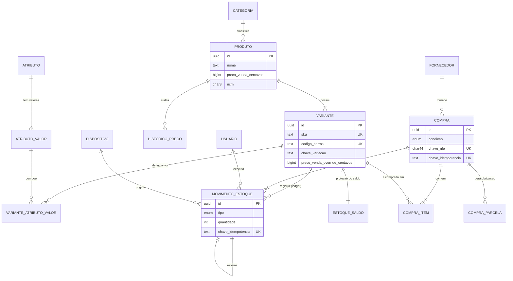

# 01 · Modelagem do domínio v4: Produto, Variante, Estoque (ledger) e Compras

> Status: **RASCUNHO v4.1 PARA CURADORIA**. Substitui a v1, a v2 e a v3.
> Nada aqui é decisão final até o Edy aprovar. Itens que mudaram em relação à v3 estão marcados com **[v4]**; as marcas **[v3]** das versões anteriores foram mantidas.

## 0. O que mudou da v4 para a v4.1

1. **Back-end aprovado [v4.1]:** TypeScript + NestJS + PostgreSQL (D-16).
2. **Troca só por item de mesmo valor [v4.1]** (D-20); a diferença de valor deixa de existir.
3. **Limite de desconto [v4.1]:** Vendedor 5%, Gerente 15%, ADM sem limite.
4. **Balcão com Windows; impressora assumida como térmica clássica [v4.1]** (USB, 80 mm, ESC/POS). O modelo segue pendente, mas não bloqueia o código.
5. **Sem venda para CNPJ, confirmado pelo dono [v4.1].**

### Histórico: o que mudou da v3 para a v4

1. **Impressão só no computador [v4].** Venda feita no celular ou tablet não imprime no MVP.
2. **Back-end proposto [v4]:** TypeScript + NestJS, com a justificativa na seção 10.1 (você pediu a minha recomendação).
3. **Vendedor com desconto máximo de 5% [v4].**
4. **Vale-crédito removido [v4]** da política de devolução.
5. **Sem venda para CNPJ por ora [v4]:** nenhum fiscal no MVP.
6. **Custo = último custo e PWA em React SPA aprovados [v4].**

### Histórico: o que mudou da v2 para a v3

1. **Regime corrigido para MEI [v3].** A v2 dizia ME. Isso reduz o peso fiscal do MVP (seção 13, R-01).
2. **Consignado removido do MVP [v3].** Fica como evolução futura; a seção 8 mostra que adicionar depois é barato.
3. **D-04 aprovada [v3]:** saldo negativo permitido, com alertas e relatório de divergência.
4. **Preço confirmado [v3]:** valor por produto, podendo depender de tamanho/cor, com override. O modelo da v2 já atendia.
5. **Importação de XML da nota de compra antecipada [v3]** para o segundo ciclo do MVP.
6. **Desconto [v3]:** % e valor fixo, **por item e na venda toda**, tudo configurável. Isso exige regra de rateio (seção 11).
7. **Nova seção 10 [v3]:** como um único sistema web roda em celular, tablet e computador (PWA).

---

## 1. Métrica de sucesso do MVP (proposta)

Ao final de **2 semanas de piloto em paralelo** com o processo antigo:

1. **Estoque:** inventário cíclico semanal (30 SKUs ou 10% do catálogo, o que for maior) com divergência de **no máximo 1% dos SKUs contados**, e toda divergência rastreável no ledger.
2. **Caixa:** fechamento do dia em **menos de 5 minutos**, com diferença "esperado × contado" por forma de pagamento.
3. **Velocidade:** busca < 100 ms; finalizar venda < 1 s; venda típica (3 itens, 1 pagamento) em < 30 s.
4. **Offline:** zero vendas perdidas e zero duplicadas após reconexão (testado derrubando a internet de propósito).

---

## 2. Premissas confirmadas

| Tema | Situação | Impacto |
|---|---|---|
| Regime **[v3]** | **MEI** | Em geral, MEI não emite nota fiscal em venda a consumidor final (pessoa física), mas emite NF-e em venda a pessoa jurídica. **[v4]** A loja não vende para CNPJ no momento, então não há emissão fiscal no MVP; o contador só confirma. Se passar a vender para CNPJ, o fiscal entra antes |
| Caixas | 1 a 2 simultâneos | Risco de conflito offline baixo, mas não zero |
| Dispositivos **[v4]** | Celular (Android na maioria), tablet e computador (balcão com **Windows** [v4.1]) | Um único sistema web instalável (PWA), seção 10. **Impressão só pelo computador** |
| Maquininha | Comprada | Sem integração TEF no MVP; operador registra forma de pagamento e valor |
| Impressora térmica **[v4]** | Comprada; modelo desconhecido. **Premissa [v4.1]:** térmica clássica USB, 80 mm, ESC/POS, com driver para Windows | Recibo não fiscal, impresso **somente no computador** ao qual ela estiver conectada. Falta o modelo (N-02) |
| Leitor de código de barras | Será comprado | Age como teclado (HID); câmera do celular como alternativa |
| Gaveta | Não usada | Abertura de caixa é só lógica (troco inicial) |
| Internet | Online e offline | PWA com fila local (outbox) e sincronização idempotente |
| Perfis | Vendedor, Gerente, ADM | Seção 12 |
| Venda online | Instagram/WhatsApp baixam o mesmo estoque | Campo `canal` na venda ("venda online" no PDV) |
| Compras | Maioria com nota; resto cadastro do zero | Entrada manual no ciclo 1; importação de XML no ciclo 2 **[v3]** |
| Fornecedores **[v3]** | À vista e a prazo | Consignado fora do MVP |

---

## 3. Decisões do Edy já incorporadas

| Tema | Decisão |
|---|---|
| Variações | Atributos configuráveis (opção B) |
| Preço | Por produto, pode depender de tamanho/cor; override quando necessário |
| Saldo negativo | **Permitido, com sinalização** (alertas e relatórios), para não parar a fila do caixa |
| Arredondamento | Meio para cima |
| Desconto | % e valor fixo, por item e na venda, configurável |
| Consignado | Fora do MVP |
| XML da nota | Antecipar para o ciclo 2 |
| Devolução | Política proposta por Claude (seção 9), sem vale-crédito **[v4]** |
| Custo **[v4]** | Último custo |
| Front-end **[v4]** | PWA responsivo em React SPA (Vite) |
| Impressão **[v4]** | Somente no computador conectado à impressora; não imprime pelo celular |
| Desconto do Vendedor **[v4]** | Máximo de 5% |
| Venda para CNPJ **[v4]** | Não no momento |

---

## 4. Variações e preço

`Produto` é o modelo (Tênis Runner X). `Variante` é o item vendável e estocável (Runner X, numeração 38).

- **Estoque, SKU e código de barras** moram na Variante.
- **Preço de venda:** valor base no Produto; a Variante pode **sobrescrever** quando o preço depender de tamanho/cor. Preço efetivo: `COALESCE(variante.preco_venda_override_centavos, produto.preco_venda_centavos)`.
- **Atributos configuráveis:** a loja cria "Numeração", "Cor", "Tamanho", "Tom" sem deploy. Calçado: Numeração. Roupa: Cor + Tamanho. Cosmético: variante única (`chave_variacao = 'unica'`) ou Tom/Volume.
- `chave_variacao` canônica (ex.: `cor=preto|tamanho=m`) com `UNIQUE (produto_id, chave_variacao)` impede variantes duplicadas.
- Na tela de cadastro, quando o preço depende da variante, o operador define o preço por variante (override) ou aplica em lote.

---

## 5. Diagrama ER



`USUARIO` e `DISPOSITIVO` pertencem ao módulo de Autenticação (próximo documento).

---

## 6. DDL PostgreSQL (rascunho)

Convenções: `uuid` (preferência v7) gerado no cliente quando a operação nasce offline; dinheiro em `bigint` de centavos; quantidade `integer`; datas `timestamptz`; soft delete via `excluido_em`.

```sql
-- ========== CATÁLOGO ==========
CREATE TABLE categoria (
  id    uuid PRIMARY KEY,
  nome  text NOT NULL UNIQUE,
  ativo boolean NOT NULL DEFAULT true
);

CREATE TABLE fornecedor (
  id          uuid PRIMARY KEY,
  nome        text NOT NULL,
  documento   text UNIQUE CHECK (documento ~ '^[0-9]{11}$|^[0-9]{14}$'), -- CPF/CNPJ só dígitos
  telefone    text,
  ativo       boolean NOT NULL DEFAULT true,
  criado_em   timestamptz NOT NULL DEFAULT now(),
  excluido_em timestamptz
);

CREATE TABLE produto (
  id                    uuid PRIMARY KEY,
  categoria_id          uuid NOT NULL REFERENCES categoria(id),
  nome                  text NOT NULL,
  marca                 text,
  descricao             text,
  preco_venda_centavos  bigint NOT NULL CHECK (preco_venda_centavos >= 0),
  ncm                   char(8) CHECK (ncm ~ '^[0-9]{8}$'),   -- nullable: só necessário quando entrar o fiscal
  cest                  char(7) CHECK (cest ~ '^[0-9]{7}$'),
  ativo                 boolean NOT NULL DEFAULT true,
  criado_em             timestamptz NOT NULL DEFAULT now(),
  atualizado_em         timestamptz NOT NULL DEFAULT now(),
  excluido_em           timestamptz
);

CREATE TABLE atributo (
  id   uuid PRIMARY KEY,
  nome text NOT NULL UNIQUE            -- "Cor", "Tamanho", "Numeração"
);

CREATE TABLE atributo_valor (
  id          uuid PRIMARY KEY,
  atributo_id uuid NOT NULL REFERENCES atributo(id),
  valor       text NOT NULL,           -- "Preto", "M", "38"
  ordem       integer NOT NULL DEFAULT 0,
  UNIQUE (atributo_id, valor)
);

CREATE TABLE variante (
  id                              uuid PRIMARY KEY,
  produto_id                      uuid NOT NULL REFERENCES produto(id),
  sku                             text NOT NULL UNIQUE,
  codigo_barras                   text UNIQUE,
  chave_variacao                  text NOT NULL,
  preco_custo_centavos            bigint NOT NULL DEFAULT 0 CHECK (preco_custo_centavos >= 0),
  preco_venda_override_centavos   bigint CHECK (preco_venda_override_centavos >= 0), -- NULL = usa o do produto
  estoque_minimo                  integer NOT NULL DEFAULT 0 CHECK (estoque_minimo >= 0),
  ativo                           boolean NOT NULL DEFAULT true,
  criado_em                       timestamptz NOT NULL DEFAULT now(),
  atualizado_em                   timestamptz NOT NULL DEFAULT now(),
  excluido_em                     timestamptz,
  UNIQUE (produto_id, chave_variacao)
);

CREATE TABLE variante_atributo_valor (
  variante_id       uuid NOT NULL REFERENCES variante(id),
  atributo_valor_id uuid NOT NULL REFERENCES atributo_valor(id),
  PRIMARY KEY (variante_id, atributo_valor_id)
);

CREATE TABLE historico_preco (        -- audita preço do produto e override da variante
  id             uuid PRIMARY KEY,
  produto_id     uuid REFERENCES produto(id),
  variante_id    uuid REFERENCES variante(id),
  campo          text NOT NULL CHECK (campo IN ('CUSTO','VENDA','VENDA_OVERRIDE')),
  valor_anterior bigint,
  valor_novo     bigint,
  usuario_id     uuid NOT NULL,
  alterado_em    timestamptz NOT NULL DEFAULT now(),
  CHECK (num_nonnulls(produto_id, variante_id) = 1)
);

-- ========== COMPRAS ==========
CREATE TYPE condicao_compra AS ENUM ('A_VISTA', 'A_PRAZO');   -- [v3] sem CONSIGNADO

CREATE TABLE compra (
  id                  uuid PRIMARY KEY,
  fornecedor_id       uuid NOT NULL REFERENCES fornecedor(id),
  condicao            condicao_compra NOT NULL,
  numero_nota         text,
  chave_nfe           char(44) UNIQUE CHECK (chave_nfe ~ '^[0-9]{44}$'),  -- impede importar a mesma nota 2x
  emitida_em          date,
  total_centavos      bigint NOT NULL CHECK (total_centavos >= 0),
  status              text NOT NULL DEFAULT 'RASCUNHO'
                        CHECK (status IN ('RASCUNHO','CONFIRMADA','CANCELADA')),
  usuario_id          uuid NOT NULL,
  chave_idempotencia  text NOT NULL UNIQUE,
  criado_em           timestamptz NOT NULL DEFAULT now()
);

CREATE TABLE compra_item (
  id                      uuid PRIMARY KEY,
  compra_id               uuid NOT NULL REFERENCES compra(id),
  variante_id             uuid NOT NULL REFERENCES variante(id),
  quantidade              integer NOT NULL CHECK (quantidade > 0),
  custo_unitario_centavos bigint NOT NULL CHECK (custo_unitario_centavos >= 0)
);

CREATE TABLE compra_parcela (          -- só A_PRAZO; no Financeiro vira ContaPagar
  id              uuid PRIMARY KEY,
  compra_id       uuid NOT NULL REFERENCES compra(id),
  numero          integer NOT NULL,
  vencimento      date NOT NULL,
  valor_centavos  bigint NOT NULL CHECK (valor_centavos > 0),
  UNIQUE (compra_id, numero)
);

-- ========== LEDGER DE ESTOQUE (append-only) ==========
CREATE TYPE tipo_movimento AS ENUM (
  'ENTRADA_COMPRA', 'SAIDA_VENDA', 'DEVOLUCAO_CLIENTE',
  'DEVOLUCAO_FORNECEDOR', 'PERDA_AVARIA',
  'AJUSTE_INVENTARIO', 'ESTORNO'
);

CREATE TABLE movimento_estoque (
  id                  uuid PRIMARY KEY,
  variante_id         uuid NOT NULL REFERENCES variante(id),
  tipo                tipo_movimento NOT NULL,
  quantidade          integer NOT NULL,               -- COM SINAL: entrada +, saída -
  origem_tipo         text NOT NULL,                  -- 'VENDA','COMPRA','DEVOLUCAO','INVENTARIO','MANUAL'
  origem_id           uuid,
  motivo              text,
  estorno_de_id       uuid REFERENCES movimento_estoque(id),
  usuario_id          uuid NOT NULL,
  dispositivo_id      uuid NOT NULL,
  chave_idempotencia  text NOT NULL UNIQUE,
  ocorrido_em         timestamptz NOT NULL,           -- relógio do dispositivo
  registrado_em       timestamptz NOT NULL DEFAULT now(), -- relógio do servidor
  CONSTRAINT qtd_nao_zero CHECK (quantidade <> 0),
  CONSTRAINT sinal_coerente CHECK (
       (tipo IN ('ENTRADA_COMPRA','DEVOLUCAO_CLIENTE') AND quantidade > 0)
    OR (tipo IN ('SAIDA_VENDA','DEVOLUCAO_FORNECEDOR','PERDA_AVARIA') AND quantidade < 0)
    OR (tipo IN ('AJUSTE_INVENTARIO','ESTORNO'))
  ),
  CONSTRAINT motivo_obrigatorio CHECK (
    tipo NOT IN ('AJUSTE_INVENTARIO','ESTORNO','PERDA_AVARIA') OR motivo IS NOT NULL
  ),
  CONSTRAINT estorno_referencia CHECK ((tipo = 'ESTORNO') = (estorno_de_id IS NOT NULL))
);

CREATE INDEX ix_mov_variante_data ON movimento_estoque (variante_id, registrado_em);

CREATE FUNCTION bloqueia_alteracao_ledger() RETURNS trigger AS $$
BEGIN
  RAISE EXCEPTION 'movimento_estoque é append-only; use ESTORNO';
END; $$ LANGUAGE plpgsql;

CREATE TRIGGER trg_ledger_imutavel
  BEFORE UPDATE OR DELETE ON movimento_estoque
  FOR EACH ROW EXECUTE FUNCTION bloqueia_alteracao_ledger();

-- ========== PROJEÇÃO DO SALDO ==========
CREATE TABLE estoque_saldo (
  variante_id   uuid PRIMARY KEY REFERENCES variante(id),
  saldo         integer NOT NULL DEFAULT 0,           -- pode ser negativo (D-04 aprovada)
  atualizado_em timestamptz NOT NULL DEFAULT now()
);
```

### Gravação idempotente + saldo na mesma transação

```sql
WITH mov AS (
  INSERT INTO movimento_estoque (
    id, variante_id, tipo, quantidade, origem_tipo, origem_id,
    usuario_id, dispositivo_id, chave_idempotencia, ocorrido_em
  ) VALUES ($1,$2,$3,$4,$5,$6,$7,$8,$9,$10)
  ON CONFLICT (chave_idempotencia) DO NOTHING
  RETURNING variante_id, quantidade
)
INSERT INTO estoque_saldo (variante_id, saldo)
SELECT variante_id, quantidade FROM mov
ON CONFLICT (variante_id)
DO UPDATE SET saldo = estoque_saldo.saldo + EXCLUDED.saldo,
              atualizado_em = now();
```

---

## 7. Offline, idempotência e saldo negativo

1. **Append-only:** nada se sobrepõe; cada fato é uma linha nova.
2. **Identidade nasce no cliente:** `id` e `chave_idempotencia` gerados antes do envio (ex.: `venda:{id}:item:{n}:saida`).
3. **`UNIQUE` + `ON CONFLICT DO NOTHING`:** reenvio vira no-op; o banco arbitra.
4. **Saldo é soma, soma é comutativa:** a ordem de sincronização não muda o saldo final.
5. **Resposta por item** (`criado`, `duplicado`, `rejeitado`); o PDV só remove da fila o que o servidor confirmou.
6. **Numeração legível por dispositivo** (`CX1-000123`), sem sequencial global.

**Saldo negativo (D-04 aprovada) [v3].** A venda nunca é bloqueada por falta de saldo. Em troca, o sistema precisa **dar visibilidade**, senão o negativo vira estoque "mentiroso" silencioso:
- Aviso no PDV quando a venda leva a variante abaixo de zero (aviso, não trava).
- Relatório diário de divergência: variantes com `saldo < 0` e ajustes de inventário do período.
- Parâmetro `permitir_estoque_negativo` (padrão: verdadeiro), mantendo a regra configurável.
- Saída do negativo: só por entrada de compra, devolução ou `AJUSTE_INVENTARIO` com motivo. Nunca editando o saldo.

**Performance:** `SUM` indexado de uma variante provavelmente cumpre 100 ms para uma loja só (medir). Mesmo assim, `estoque_saldo` na mesma transação + job que compara com `SUM(ledger)` e alerta divergência. O ledger sempre vence.

---

## 8. Compras e fornecedores

| Condição | Estoque | Financeiro |
|---|---|---|
| **À vista** | `ENTRADA_COMPRA` (+) | Pagamento no ato; sem parcela |
| **A prazo** | `ENTRADA_COMPRA` (+) | Gera `compra_parcela` (vira ContaPagar). Soma das parcelas = total, resto de centavos na última parcela |

**Fluxo:** `RASCUNHO` → `CONFIRMADA` (gera movimentos + parcelas na mesma transação, com idempotência `compra:{id}:item:{n}`) → `CANCELADA` (gera `ESTORNO`, nunca apaga).

**Ciclo 1:** entrada manual (nº da nota, fornecedor, itens, custo). **Ciclo 2 [v3]:** importação do XML da nota, preenchendo fornecedor, itens e valores; `chave_nfe` UNIQUE impede importar a mesma nota duas vezes. O ponto difícil do XML é o **casamento item do XML ↔ variante da loja** (o código do fornecedor não é o seu SKU). Isso pede uma tabela de equivalência fornecedor+código → variante, que aprende com o uso.

**Custo:** `compra_item` guarda o custo de cada compra (histórico). A variante usa **último custo** no MVP; custo médio ponderado depois (N-04).

**Consignado, futuro:** adicionar depois é barato, porque o ledger não muda de estrutura: `ALTER TYPE tipo_movimento ADD VALUE 'ENTRADA_CONSIGNACAO'`, valor `CONSIGNADO` em `condicao_compra` e um vínculo variante ↔ fornecedor consignante. O difícil é o acerto financeiro, e esse só vale desenhar quando o caso real aparecer.

---

## 9. Política de troca e devolução (proposta, parametrizável)

| Tema | Proposta |
|---|---|
| Prazo de troca na loja | `prazo_troca_dias = 7` (configurável) |
| Venda online (Instagram/WhatsApp) | Mínimo de 7 dias para arrependimento (CDC, art. 49); não configurável abaixo disso |
| Defeito | Segue o CDC; sem prazo próprio da loja |
| Resolução **[v4]** | **Sem vale-crédito.** Troca **apenas por item do mesmo valor [v4.1]** (sem pagar nem receber diferença) ou estorno no meio de pagamento original. Na loja física, sem defeito, o padrão é **só troca**; estorno é obrigatório em arrependimento online e em defeito não sanado. Critério de "mesmo valor": ver N-10 |
| Exigência | Devolução sempre **vinculada à venda original** |
| Valor devolvido | O **valor líquido pago** pelo item, já com o desconto rateado (seção 11) |
| Aprovação | Vendedor registra; Gerente aprova acima de limite parametrizado |
| Cosmético aberto | Não volta ao estoque vendável |

**No ledger:** item revendável → `DEVOLUCAO_CLIENTE` (+1). Não revendável → `DEVOLUCAO_CLIENTE` (+1) **e** `PERDA_AVARIA` (−1) com motivo, para o ledger contar a história completa.

> Proposta de produto, não parecer jurídico. Validar com contador/advogado antes do go-live.

---

## 10. Um sistema web para celular, tablet e computador **[v3]**

**Resposta curta:** sim, é exatamente o caminho recomendado. O nome da técnica é **PWA (Progressive Web App)**: um site responsivo que o usuário **instala na tela inicial**, abre em tela cheia como um app e que continua funcionando offline.

**Como "lança" no mobile:** não existe loja de apps no MVP. Você publica o sistema em um domínio com HTTPS; no celular, o operador abre o endereço e escolhe "Adicionar à tela inicial". Atualização é só fazer deploy: todo mundo recebe a nova versão.

| Opção | O que é | Veredito |
|---|---|---|
| Site responsivo comum | Adapta ao tamanho de tela, mas sem instalação nem offline | Insuficiente (você precisa de offline) |
| **PWA** | Site responsivo + instalável + offline (service worker + IndexedDB) | **Recomendada**: 1 código, 3 dispositivos |
| PWA + empacotador (Capacitor) | O mesmo código, embrulhado como app nativo | **Plano B**, só se algo do celular for bloqueio (ex.: impressora Bluetooth) |
| App nativo (Android/iOS separados) | Dois códigos | Fora de cogitação para este time |

**Responsivo por papel, não só por tamanho de tela:**
- **Celular:** PDV de balcão, consulta de estoque, cadastro rápido, aprovação de devolução.
- **Tablet:** PDV no balcão e inventário (contagem andando pela loja).
- **Computador:** gestão, cadastro em massa, importação de XML, relatórios.

**Limites reais que o PWA tem (e o modelo já considera):**
1. **Armazenamento offline no celular:** o navegador pode limpar dados de sites pouco usados. PWA instalado na tela inicial é tratado melhor; pedir `navigator.storage.persist()`, sincronizar sempre que houver rede e alertar sobre itens pendentes há muito tempo.
2. **Leitura de código pela câmera:** o `BarcodeDetector` nativo não existe em todos os navegadores (notadamente iPhone). Usar uma biblioteca (tipo ZXing) como base, não como fallback. Como a maioria dos celulares é Android (Chrome), o detector nativo tende a funcionar, mas a biblioteca cobre o resto.
3. **Impressora térmica [v4]:** decisão do Edy: **imprimir só no computador**. Isso tira do MVP o maior risco técnico do mobile (Web Bluetooth não existe no iPhone, e muitas térmicas baratas usam Bluetooth clássico, que o navegador não acessa). Na prática: o computador do balcão tem a impressora instalada no sistema; o PWA imprime com `window.print()` usando CSS para bobina de 58 ou 80 mm, e o Chrome em modo `--kiosk-printing` imprime direto na impressora padrão, sem abrir a janela de impressão a cada venda. ESC/POS direto (WebUSB) fica como melhoria futura. Falta saber o **modelo** para confirmar se há driver para o Windows do balcão (N-02). Venda feita no celular: **recibo digital opcional** (link/PDF por WhatsApp), que também serve às vendas online.
4. **Notificações push no iPhone** só funcionam com o PWA instalado.

**Stack (front aprovado em D-11 [v4]):** para o front, minha recomendação é **React SPA (Vite + plugin PWA/Workbox)** em vez de Next.js no PDV. O sistema fica atrás de login e é offline-first; renderização no servidor ajuda pouco e complica o cache offline. Next.js continua fazendo sentido para uma futura loja virtual pública (Fase 3). O back-end está na seção 10.1.

### 10.1 Back-end proposto **[v4]**

Como você não domina uma linguagem de back-end, os critérios passam a ser: **menor curva**, **mais proteção contra erro** (dinheiro e estoque) e **boa convivência com IA** (Cursor/Antigravity).

**Proposta: TypeScript + NestJS + PostgreSQL.**

1. **Uma linguagem nos dois lados.** O PWA (React) e o servidor falam TypeScript. O contrato de sincronização offline (a fila de operações com `chave_idempotencia`) fica tipado de ponta a ponta, e o mesmo schema de validação (ex.: Zod) vale no aparelho e no servidor. Esse contrato é o coração do sistema.
2. **Tipagem estática como rede de proteção.** O compilador barra boa parte dos erros que código gerado por IA costuma introduzir. Importa muito em módulo que mexe com dinheiro.
3. **NestJS impõe estrutura.** Módulos, injeção de dependência e camadas casam com o "monólito modular" e com a separação domínio/aplicação/infraestrutura das instruções do projeto. Contrapartida honesta: a curva inicial (decorators, DI) é mais íngreme que um Express puro.
4. **Acesso a dados SQL-first.** Sugiro **Drizzle** (ou Kysely): migrações versionadas e liberdade para escrever a CTE idempotente da seção 6 sem brigar com o ORM. Prisma é mais amigável, mas aquela consulta seria SQL cru de qualquer forma.
5. **Testes contra Postgres real** (container, ex.: Testcontainers). As garantias do ledger vivem no banco (trigger, CHECK, UNIQUE); mock não prova nada disso.

**Descartadas, e por quê:** Java/Spring (excelente, mas curva e verbosidade maiores, e seriam duas linguagens); Python/FastAPI (rápido para começar, mas tipagem opcional e também duas linguagens); C#/.NET (ótimo, mas mesma objeção de duas linguagens).

**Regra de ouro para quem está aprendendo com IA:** a IA escreve o rascunho; **os testes da seção 14 são o contrato**. Você lê e escreve os testes primeiro; código que não passa neles não entra.

---

## 11. Dinheiro, desconto e arredondamento

- Tudo em centavos inteiros. Percentual em **pontos-base** (10% = 1000 bp).
- **Meio para cima, em inteiros:** `desconto = (base * bp + 5000) / 10000` (divisão inteira). Ex.: 3335 centavos a 10% → 334; total 3001.
- **Desconto em % ou valor fixo, por item e/ou na venda toda [v3]**, cada um habilitável por parâmetro. Limite máximo por perfil também em parâmetro. **[v4]** Vendedor: **5%** (decisão do dono), medido sobre o **total bruto da venda**, somando desconto de item e de venda; desconto em valor fixo é convertido em % equivalente para a checagem. Acima do limite, exige aprovação do Gerente. Gerente: **15%**; ADM: **sem limite [v4.1]**.
- Desconto nunca excede a base a que se aplica.
- **Rateio [v3]:** o desconto da venda toda é distribuído **proporcionalmente** entre os itens. A soma dos descontos rateados tem de ser exatamente o desconto total; a sobra de centavos vai para o item de maior valor. Por quê: sem rateio, não dá para calcular quanto devolver quando o cliente devolve só um item de uma venda com desconto, e a nota fiscal futura também exige isso.
- Ordem de aplicação: descontos por item primeiro, depois o desconto da venda sobre o subtotal já com os descontos de item.

---

## 12. Perfis (insumo para o módulo de Autenticação)

| Ação | Vendedor | Gerente | ADM |
|---|---|---|---|
| Vender, consultar estoque | sim | sim | sim |
| Abrir/fechar o próprio caixa | sim | sim | sim |
| Desconto até o limite do perfil | sim | maior limite | maior limite |
| Cancelar venda, aprovar devolução | não | sim | sim |
| Entrada de compra, ajuste de estoque | não | sim | sim |
| Alterar preços, parâmetros, usuários | não | não | sim |
| Relatórios financeiros | não | parcial | sim |

Rascunho; vira matriz de permissões em tabela (não em código).

---

## 13. Riscos

| ID | Risco | Mitigação |
|---|---|---|
| R-01 **[v4]** | Regime MEI: limite anual de faturamento; e obrigação de NF-e se a loja passar a vender para CNPJ | Hoje sem venda a CNPJ. Relatório simples de **faturamento acumulado no ano × limite** (parâmetro). Avisar no PDV se o cliente cadastrado tiver CNPJ, enquanto não existir fiscal |
| R-02 **[v4]** | Impressão térmica | Impressão só no computador (decisão); modelo desconhecido, confirmar driver para o Windows do balcão; recibo digital no celular |
| R-03 | Perda da outbox offline no celular | Storage persistente, sync agressivo, alerta de pendências |
| R-04 | Saldo negativo escondendo erro ou perda | Alerta no PDV, relatório diário de divergência, inventário cíclico |
| R-05 **[v3]** | Casamento item do XML ↔ variante gerar entrada errada | Tela de conferência antes de confirmar a compra; tabela de equivalência |

---

## 14. Casos de teste que o modelo precisa passar

| # | Dado | Quando | Então |
|---|---|---|---|
| T-01 | Saldo 10, venda de 2 | Mesma venda sincronizada 3x | Saldo 8; 1 linha no ledger; respostas: criado, duplicado, duplicado |
| T-02 | Operações A e B offline | B sincroniza antes de A | Saldo final igual ao da ordem A, B |
| T-03 | Saída lançada por engano | `UPDATE`/`DELETE` no ledger | Banco rejeita; correção só por `ESTORNO` com motivo |
| T-04 | Estorno de saída de 2 | Aplica | Saldo volta; estorno referencia o original |
| T-05 | Qualquer sequência de operações | Fim do teste | `estoque_saldo.saldo == SUM(ledger)` para toda variante |
| T-06 | Saldo 1, dois dispositivos vendem 1 offline | Ambos sincronizam | Saldo -1, ambas aceitas, aparece no relatório de divergência |
| T-07 | Variante Preto/M já existe | Cadastra outra igual no produto | Rejeitada por `UNIQUE (produto_id, chave_variacao)` |
| T-08 | `AJUSTE_INVENTARIO` ou `PERDA_AVARIA` sem motivo | Tenta gravar | Rejeitado pelo CHECK |
| T-09 | Item de R$ 33,35, desconto 10% | Calcula em inteiros | Desconto 334, total 3001 (meio para cima) |
| T-10 | Desconto fixo maior que a base | Aplica | Rejeitado |
| T-11 | Compra de R$ 100,00 em 3 parcelas | Gera parcelas | 3333 + 3333 + 3334; soma = 10000 |
| T-12 | Compra confirmada e depois cancelada | Cancela | Gera `ESTORNO`; saldo volta; compra marcada `CANCELADA`; nada apagado |
| T-13 | Venda com `canal = INSTAGRAM` | Sincroniza | Baixa o mesmo saldo da venda de balcão |
| T-14 | Devolução de cosmético aberto | Registra | `DEVOLUCAO_CLIENTE` +1 e `PERDA_AVARIA` −1; saldo vendável não aumenta |
| T-15 | Mesma nota (`chave_nfe`) confirmada duas vezes | Confirma de novo | Rejeitada ou no-op; entradas não duplicam |
| T-16 | Variante sem override | Calcula preço efetivo | Usa o preço do produto; com override, usa o da variante |
| T-17 **[v3]** | Venda de 3 itens com desconto de venda de R$ 10,00 | Rateia | Soma dos descontos rateados = 1000 exatos |
| T-18 **[v3]** | Venda com desconto rateado; devolve 1 item | Calcula valor devolvido | Valor líquido pago por aquele item, não o preço de tabela |
| T-19 **[v3]** | Desconto por item e por venda na mesma venda | Calcula total | Item primeiro, depois venda sobre o subtotal; total sem float |
| T-20 **[v4]** | Vendedor aplica desconto total de 5,00% e depois de 5,01% | Valida | 5,00% passa; 5,01% exige aprovação do Gerente; item + venda somados no limite |
| T-21 **[v4]** | Devolução sem defeito, loja física, dentro do prazo | Registra | Só troca é permitida; estorno rejeitado (sem vale-crédito) |
| T-22 **[v4.1]** | Troca de um item por outro de preço de tabela diferente | Registra | Rejeitada como troca; nenhuma diferença em dinheiro é gerada |

---

## 15. Decisões (ADRs rascunho)

| ID | Decisão | Alternativa | Status |
|---|---|---|---|
| D-01 | Ledger append-only; correção por estorno | Editar saldo direto | Proposta |
| D-02 | Idempotência por `chave_idempotencia` UNIQUE + `ON CONFLICT DO NOTHING` | Checar na aplicação (tem corrida) | Proposta |
| D-03 | Atributos configuráveis; preço no Produto + override na Variante | Colunas fixas | **Aprovada** |
| D-04 | Saldo negativo permitido, com alerta e relatório | Bloquear venda | **Aprovada** |
| D-05 | Projeção `estoque_saldo` + reconciliação | Só `SUM` | Proposta |
| D-06 | Centavos `bigint`; quantidade `integer`; percentual em pontos-base | `numeric` | Proposta |
| D-07 | UUID (preferência v7) gerado no cliente | `serial` global | Proposta |
| D-08 | MVP sem TEF e sem emissão fiscal; recibo não fiscal. Fiscal futuro | Integrar já | **Aprovada [v4]** (MEI, sem venda para CNPJ); contador só confirma |
| D-09 | ~~Consignação~~ | | **Removida do MVP** |
| D-10 | Política de devolução parametrizável (seção 9), **sem vale-crédito [v4]** | Regra fixa | Proposta |
| D-11 | PWA responsivo, 1 código para 3 dispositivos; React SPA (Vite) | App nativo; Next.js no PDV | **Aprovada [v4]** |
| D-12 | Perfis Vendedor/Gerente/ADM com permissões em tabela | Perfis fixos em código | Proposta |
| D-13 | Venda online = `canal` na venda; mesmo estoque | Estoque por canal | Proposta |
| D-14 **[v3]** | Desconto por item e por venda, % ou fixo, com rateio proporcional | Só desconto na venda | Proposta |
| D-15 **[v3]** | Importação de XML no ciclo 2, com tabela de equivalência fornecedor+código → variante | Fase 2 distante | **Aprovada** (antecipação) |
| D-16 **[v4]** | Back-end em TypeScript + NestJS + PostgreSQL; Drizzle (ou Kysely); testes contra Postgres real (seção 10.1) | Java/Spring, Python/FastAPI, .NET | **Aprovada [v4.1]** |
| D-17 **[v4]** | Impressão somente no computador; celular com recibo digital opcional | Impressão por celular | **Aprovada** |
| D-18 **[v4]** | Custo da variante = último custo | Custo médio ponderado | **Aprovada** |
| D-19 **[v4]** | Desconto máximo por perfil, sobre o total bruto, parametrizável: Vendedor 5%, Gerente 15%, ADM sem limite **[v4.1]** | Sem limite | **Aprovada** |
| D-20 **[v4.1]** | Troca somente por item de mesmo valor (sem diferença em dinheiro) | Troca com diferença | **Aprovada** |

---

## 16. Pendências

**Resolvidas [v4.1]:** back-end TypeScript + NestJS + PostgreSQL (D-16); balcão com Windows; impressora assumida como térmica clássica (USB, 80 mm, ESC/POS); limite de desconto do Gerente em 15% (ADM sem limite, sugestão aceita junto); troca apenas por item de mesmo valor; MEI sem venda para CNPJ, confirmado pelo dono.

**Pendentes (nenhuma bloqueia o início do código)**
- **N-02 (dono):** marca e modelo da impressora, quando houver. Se for só Bluetooth ou não tiver driver para Windows, o plano de impressão é revisto.
- **N-10 (dono):** "mesmo valor" significa mesmo **preço de tabela** (ex.: mesmo produto em outro tamanho/cor, ou outro produto com o mesmo preço)? Se a venda original teve desconto, o item novo herda o mesmo desconto? Minha proposta: sim, o valor líquido pago se mantém.
- **N-01 (contador):** confirmação formal de que MEI sem venda a CNPJ dispensa emissão de nota no Amazonas.
- **Ao comprar o leitor de código de barras:** escolher um que funcione como teclado (HID) e envie Enter ao final do código.

---

## 17. Próximos passos

1. Dono confirma N-02 (modelo da impressora) e N-10; contador confirma N-01. Nenhum bloqueia o início do código.
2. Documento 02 (**Autenticação, perfis, dispositivos e auditoria**) enviado para curadoria.
3. Curadoria do documento 02 e aprovação das ADRs dos dois documentos.
4. Aprovadas as decisões, registrar como ADRs em `docs/adr/`.
5. Gerar o arquivo de contexto para Cursor/Antigravity a partir das decisões aprovadas.
6. Só então: repositório, Docker, Postgres, migrações e o primeiro módulo (Produtos + Estoque).
